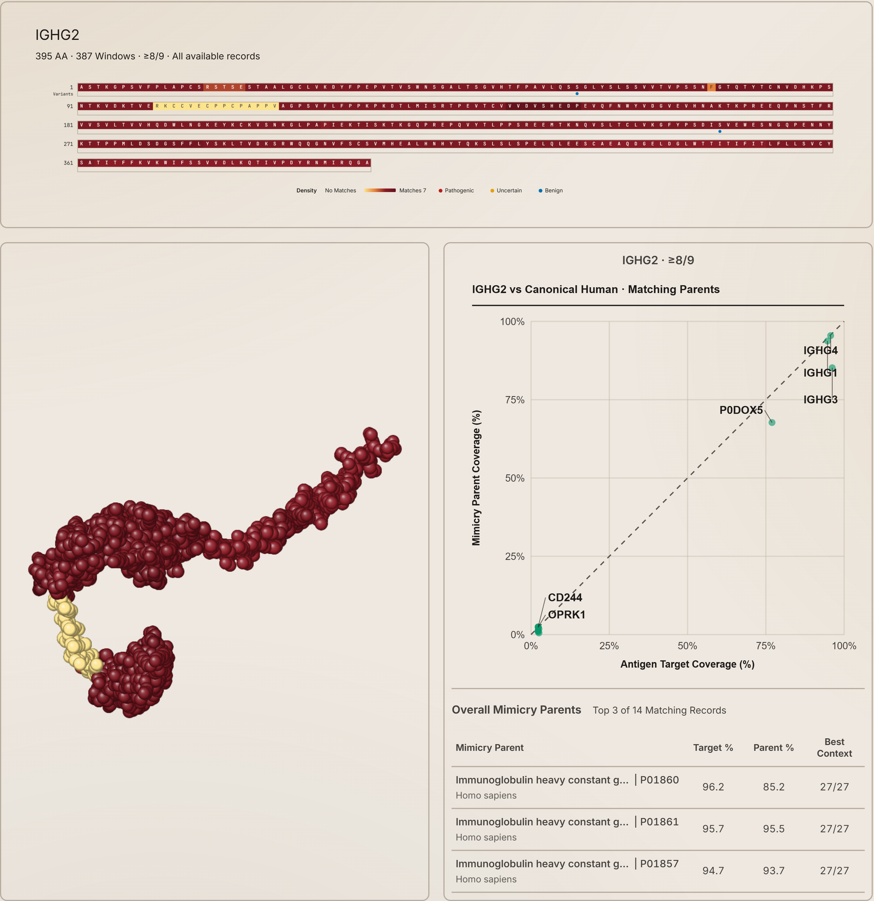

# MimicryMap

**Map antigen-specific sequence resemblance within and across proteomes.**

MimicryMap was created to comprehensively map linear molecular mimicry events between common exposures and the human proteome, with a method generalizable to mapping similarity within and across literal biological datasets from multiplex seromics platforms. It is available as an interactive web viewer, a CPU-only pipeline and an NVIDIA GPU-accelerated pipeline for proteome-scale mapping.

The method searches all complete overlapping nine-residue windows from a given protein sequence (**antigen target**) against a candidate molecular mimic sequence (**mimicry parent**), at a chosen threshold of exact matching residues (**minimum identity**). The viewer shows the matching cores, their surrounding sequence context, and the union of residue positions they cover on each sequence (**target coverage** and **parent coverage**).

The method is library agnostic. Human proteins and 120 viral proteomes form the worked atlas; microbiome, food, allergen, assay and other custom sequences can be compared in the same way. Sequence-defined sets could also support downstream analyses of antibody reactivity. Sequence resemblance identifies candidates for investigation; it does not by itself demonstrate shared antibody binding. Matching uses linear sequences; available structure and residue annotations provide context without changing the matching rule. The accompanying [comparison libraries](docs/SUMMARY-DOWNLOADS.md) also include canonical exposures assembled from IEDB-selected protein antigens, UniProt Allergome-tagged proteins, the viral set and retained exposure references, alongside CDI Labs HuProt 4.0, HuScan and VirScan/Exposome sequence comparisons.

[](docs/VIEWER.md)

*The viewer comparing human IL10 with its EBV homolog, with the optional AlphaFold structure and pLDDT track. The sequence map, aligned core, coverage table and exports stay together in one view.*

[Run the Web Viewer](docs/VIEWER.md) · [Interface Guide](docs/USAGE.md) · [How It Works](#how-mimicry-results-are-calculated) · [Worked Examples](#how-to-use-mimicry-results) · [Atlas and Data](docs/ATLAS.md) · [Citation and License](#citation-and-license)

## Explore, Inspect, Reuse

Start with a target and parent FASTA, inspect matching regions, then export the
figures, tables or inputs needed for the next step. The browser viewer, detailed
CPU comparison and CPU/GPU library builder use the same matching definitions.

| Task | Route | Outputs |
| --- | --- | --- |
| Inspect one target interactively | [Web viewer](docs/VIEWER.md), with the supplied example or your FASTAs | Sequence maps, aligned cores and context, target/parent coverage, CSVs and figure exports |
| Run detailed comparisons locally | [CPU pipeline](#run-a-detailed-comparison-cpu), from Python, R or Node.js | Per-target window matches and a combined coverage summary |
| Compare two complete libraries | [CPU/GPU library builder](docs/BUILD.md) | Reusable mapping databases and CSV + FASTA packages; full positions optional |
| Explore completed human–viral comparisons | [Pan-Viral Atlas and data](docs/ATLAS.md) | Saved figures, coverage tables, exact input FASTAs and reference mappings |

To launch the viewer locally with Node.js 24 or later:

```sh
npm run viewer
```

Open **http://127.0.0.1:5408/examples/index.html** and click **Compare Sequences**
for the small IL10 example, or supply your own FASTAs. No database or antibody
study is required. [Run the Web Viewer](docs/VIEWER.md) covers the optional
structure example, Human Canonical + 120 Viral Proteomes preset, static hosting,
embedding and transferable viewer ZIP.

The hosted site adds catalogue search, the saved pan-viral atlas, illustrated
methods and data downloads. Curated browsing uses separately supplied reference
assets; these are not required for a standalone FASTA comparison.
The [interface guide](docs/USAGE.md) connects each route to its outputs.

## Build Reusable Libraries

The library builder needs Node.js 24 or later. It compares supplied FASTAs
and writes reusable mappings without an installed study:

```sh
node build.cjs --targets inputs/antigen-target.fasta --parents inputs/mimicry-parents.fasta --out outputs/example-index
```

For NVIDIA acceleration, add `--engine gpu --python /path/to/CUDA/python`.
CPU and GPU support 5/9–9/9; the default floor is 7/9. Add `--floor 5` or
`--floor 6` for lower-threshold research builds, and `--retain-positions` when
complete saved window-pair lookups are needed. See [Build Libraries](docs/BUILD.md) for
installation, outputs and reproduction.

## Run a detailed comparison (CPU)

Use this checkout, a pipeline ZIP, or **Current Comparison** exported from the
viewer. The supplied pipeline example is HEPACAM–EBNA1; a Current Comparison
contains the selected viewer inputs. Extract the whole ZIP when using a download,
then run from the package folder:

- **Python:** run `python run.py`, or open run.py in your Python editor and run it.
- **R or RStudio:** set the working directory to the package, then run `source("run.R")`.
- **Terminal:** run `Rscript run.R` or `node run.cjs`.

The Python and R launchers set up Node.js locally if needed. Initial setup requires internet access; subsequent calculations run locally. Windows R requires version 4.2 or later.

## Change the comparison

<table width="100%">
<thead><tr>
<th align="left" width="360">File</th>
<th align="left" width="600">What to edit</th>
</tr></thead>
<tbody>
<tr><td><code>inputs/antigen-target.fasta</code></td><td>One or more target records</td></tr>
<tr><td><code>inputs/mimicry-parents.fasta</code></td><td>The parent records to compare against</td></tr>
<tr><td><code>settings.json</code></td><td>Identity threshold, optional selected target start, and output folder</td></tr>
</tbody>
</table>

`min_identity` is an integer from 5 to 9. `selected_target_start` is a 1-based start, or `null` to omit the current-window table. Paths are relative to settings.json. Targets run one at a time; unlike the browser, the local pipeline processes every supplied target.

Current Comparison downloads retain the selected record labels, coordinate mappings and available annotations. Keep the supplied input files unchanged to reuse that information. If you change FASTA headers, sequences or record order, or add records, the package reads the new inputs using their FASTA headers. Missing gene, accession and organism information stays blank. See the [Input Guide](inputs/README.md) for supported headers and metadata details.

The IL10, HEPACAM and IGHG2 History shortcuts use the same exporters and runnable package as any other selected target. Saved worked-example ZIPs contain historical figures and tables. Public reference FASTA headers and Summary CSV headers match the corresponding released sequence records; storage hashes remain only in supporting metadata where needed for joins. To reproduce a released comparison, use its exact FASTAs and threshold: the interface's broader Human library and filtered Exposures scopes can contain different populations.

## Results

Each target has a folder under `outputs/targets/` containing:

- `comparison_summary.csv`, one row with 7/9, 8/9 and 9/9 summary column groups
- `all-matches.csv`
- `overall-mimicry-parents.csv`
- `current-window-slice.csv`, when a target start is selected

`outputs/library_summary.csv` combines the summary rows for all supplied targets.

`run.json` summarizes the settings, counts, coverage, and timings. The inputs and their record metadata are retained once per run. Figures remain available through the site's separate Figure bundle.

Rerunning refreshes the managed output folder after completion. Choose another `output_directory` to keep a separate run. Files you add to an output folder are preserved by requiring a different output folder before replacement; a failed run leaves the previous completed output intact.

[Input Guide](inputs/README.md) · [Table Guide](docs/TABLES.md) · [Glossary](docs/GLOSSARY.md) · [File Guide](docs/FILE-GUIDE.md)

## Site downloads and this package

<table width="100%">
<thead><tr>
<th align="left" width="360">Surface</th>
<th align="left" width="600">What it provides</th>
</tr></thead>
<tbody>
<tr><td><strong>Matches CSV / Parents CSV</strong> in the player</td><td>Matching window pairs or parent summaries for the selected target, identity threshold and comparison scope</td></tr>
<tr><td><strong>PNG / SVG</strong></td><td>The selected figure or table presentation</td></tr>
<tr><td><strong>Current Comparison</strong></td><td>This runnable package with the selected target, complete comparison population, settings, and available identity, mapping and annotation metadata</td></tr>
<tr><td><strong>Plain pipeline ZIP</strong></td><td>The same code and guides with editable example inputs</td></tr>
<tr><td><strong>Mimicry coverage summaries</strong> on Data &amp; Licenses</td><td>Reference-population and assay-library comparisons, with Target FASTA and Comparison FASTA beside each CSV</td></tr>
<tr><td><strong>Mapping Database (.sqlite)</strong> on Data &amp; Licenses</td><td>Installable saved record mappings, coverage and ranges for reference membership and reuse</td></tr>
<tr><td><strong>Selected virus / All viruses</strong> on the atlas</td><td>Both human-to-virus and virus-to-human directions for the selected reference proteome or the pooled 120-proteome atlas</td></tr>
</tbody>
</table>

To use a download-table row here, save **Target FASTA** as `inputs/antigen-target.fasta` and **Comparison FASTA** as `inputs/mimicry-parents.fasta`. The first population supplies the output rows; each sequence's full length supplies its coverage denominator. Comparison FASTA includes records absent from the summary's parent lists. Replacing the inputs invalidates any previous selection metadata.

The packaged [Summary Download Guide](docs/SUMMARY-DOWNLOADS.md) explains the reference populations, CSV fields, parent-list floor, and per-pair residue ranges. Summary pairs use one decimal place for coverage percentages. App/local summaries include six additional annotation columns. FASTA inputs alone do not carry the site's mappings, grouping or residue annotations.

## HuProt HEPACAM worked example

[Download the HuProt HEPACAM figures and tables (21.5 MB)](https://github.com/seromics/mimicrymap/raw/refs/heads/main/examples/hepacam-huprot-viral-example.zip). This separate example compares HuProt HEPACAM (JHU19101; Q14CZ8) with 120 whole viral proteomes at 5/9 and 7/9, with an EBV-only 5/9 comparison at HEPACAM 376–384. It contains the saved results and figures; use the runnable package above for a new comparison.

## Reading coverage results

Target coverage is the percentage of target residues covered by qualifying nine-residue windows. Parent coverage uses the parent protein's full length. Overlapping windows cover a residue only once, and every position within a qualifying window contributes to coverage, including mismatches.

The summary includes each parent pair reaching at least 10% coverage on either side. Each pair has independently merged target and parent residue ranges. Records shorter than nine residues retain their length and sequence with empty lists.

Available target annotations accompany Current Comparison downloads and appear in their summary outputs. Replacing the input sequences means the earlier annotations no longer apply.

See the [Table Guide](docs/TABLES.md) for field definitions, coordinates and CSV formatting, and the [Summary Download Guide](docs/SUMMARY-DOWNLOADS.md) for collection-wide summaries.

<!-- calculation-walkthrough:start -->
## How Mimicry Results Are Calculated


[Method overview and worked example](docs/HOW-IT-WORKS.md)

MimicryMap compares overlapping nine-residue windows, then maps the qualifying matches back to the full records. The example below follows HEPACAM (GlialCAM) and EBNA1.

<p>The full method is below, walked through for an important example: discovery of the 5/9 molecular mimic core XSPPRXPXX shared between <strong>EBNA1</strong> (from Epstein-Barr virus) and the human neuronal protein <strong>HEPACAM</strong> (also called GlialCAM). Aberrant immunity targeting this site is found in about 1/4 of multiple sclerosis patients and <a href="https://doi.org/10.1038/s41586-022-04432-7">may be a cause of multiple sclerosis</a>. As we will see, 5/9 mimicry events to proteins like HEPACAM are commonly found across human viruses.</p>

### 1. Select Records and Comparison Scope


<p>To start, select a sequence you care about or one recognized by an experimentally identified antibody. This sequence is the <strong>antigen target</strong>. Next, you select a pool of sequences to look for molecular mimicry from; these are its potential <strong>mimicry parents</strong>. A minimum identity threshold setting defines how broad the search is.</p>

<p>Here, HEPACAM (GlialCAM; Q14CZ8) is the antigen target. All proteins from a set of 120 curated viral proteomes supply the mimicry parents. We search at a minimum identity of ≥5/9 and follow the HEPACAM-EBNA1 example through scoring and pairwise coverage.</p>

### 2. Extract Window Pairs


<p>Each sequence contributes all overlapping nine-residue window cores. This begins with the first amino acid and ends with final complete core of nine: max(0, sequence length − 8). HEPACAM contains 416 residues and therefore 408 positional window cores; the figure shows extraction across residues 367–393. Repeated sequences retain their distinct positions.</p>

```math
\begin{aligned}\mathbf{Windows\ per\ record} &= \max(0,\ \text{record length}-8) \\[8pt] \mathbf{HEPACAM:}\quad 416-8 &= 408\ \text{windows}\end{aligned}
```

<p>An identical process is done across the entire mimicry parent library. Across the 120 included viral proteomes, there are 2,222 proteins and polyproteins, with 961,063 possible mimicry windows.</p>

<p>The possible search space contains every target-parent window pairing. MimicryMap uses indexes to identify candidates, then verifies their identity.</p>

```math
\begin{aligned}\mathbf{Possible\ Window\ Pairs} &= 408\times 961{,}063 \\[8pt] &= 392{,}113{,}704\approx 3.92\times 10^8\ \text{possible pairs}\end{aligned}
```


### 3. Apply Core Threshold


<p>Candidate windows are aligned without gaps and checked for identical amino acids. At a minimum core identity of ≥5/9, five or more corresponding positions must match. Only the 20 canonical amino acids contribute identity; other symbols retain their coordinates but count as mismatches.</p>

<p>The illustrated masks show five required matches; each wildcard (*) leaves a position unrestricted, so additional matches also qualify. X marks an observed difference.</p>

<p>For the selected HEPACAM–EBNA1 pair, XSPPRXPXX shows five identical positions and four differences. This pair qualifies at 5/9 but is just one of many possible ways mimicry may occur at this site.</p>

### 4. Map Context


<p>Each qualifying core pair is extended by up to nine available residues on either side, giving an aligned context of up to 27 residues. Context total residue identity and a summed BLOSUM62 score are available to rank qualifying core pairs.</p>

<p>For the selected HEPACAM-EBNA1 5/9 core pair, the flanks add only one identical position, giving 6/27 context identity and a BLOSUM62 score of 12. If the full 27 residue context is not available due to being near the start or end of the full protein sequence, missing positions contribute neither identity nor BLOSUM62 score.</p>

### 5. Inspect and Summarize Results


<p>MimicryMap produces individual sequence matches and summaries that compile those matches for reuse. The full data viewer locates qualifying nine-residue core pairs in the target and parent sequences. At a selected site, matches can be ranked by core identity (e.g., 8/9 outranking 5/9), context identity (e.g., 20/27 outranking 6/27), or BLOSUM62 score. Individual alignments and their coordinates can be inspected and exported.</p><p>To summarize all matching events between two records, MimicryMap calculates target and parent coverage. This combines qualifying nine-residue cores into independent residue unions on each sequence. Overlapping residues count once; the entire qualifying core contributes, including mismatched positions, while context flanks are excluded. These same coverage values appear in the viewer and exported summaries:</p>

```math
\begin{aligned}\mathbf{Target\ Coverage} &= 100\times\frac{\text{covered target residues}}{\text{target length}} \\[12pt] \mathbf{Parent\ Coverage} &= 100\times\frac{\text{covered parent residues}}{\text{parent length}}\end{aligned}
```

<p>For HEPACAM versus EBNA1 alone, 21 qualifying window pairs at ≥5/9 merge into 9 + 16 + 30 = 55 covered target residues and 14 + 17 + 25 + 9 = 65 covered parent residues. Target coverage is 100 × 55/416 = 13.2%; parent coverage is 100 × 65/641 = 10.1%. These summarize all observed coordinate matches.</p>

<p>At HEPACAM residues 376-384, the EBV library yields 27 qualifying window pairs across 14 protein records at ≥5/9. Across all 120 viral proteomes, this becomes 293 pairs across 214 records, including two non-EBV pairs at ≥7/9.</p>

<p><strong>Saved window pairs at HEPACAM 376–384</strong></p>

<table width="100%">
<thead><tr><th scope="col" width="320">Parent Scope</th><th scope="col" width="320">Min Identity</th><th scope="col" width="320">Pairs</th></tr></thead><tbody><tr><th scope="row">Curated EBV B95-8 proteome</th><td>5/9</td><td>27</td></tr><tr><th scope="row">Curated Viral Proteomes (120)</th><td>5/9</td><td>293</td></tr><tr><th scope="row">Curated Viral Proteomes (120)</th><td>7/9</td><td>2</td></tr></tbody>
</table>

<a id="proteomeReactivity"></a>

These numerous matches illustrate why experimental evidence is essential for identifying biologically relevant mimicry. Across a library, reach counts distinct eligible target records with at least one qualifying match; pooled target coverage unions covered residues across the selected parents. Downloadable pair summaries retain matches at 7/9–9/9 with ≥10% coverage of either sequence. The [summary download guide](docs/SUMMARY-DOWNLOADS.md) provides premade summary CSVs for mappings within and between canonical human and exposure proteomes, curated viral proteomes and assay libraries. These portable files retain identifiers, sequences, coverage values and matched residue ranges at 7/9, 8/9 and 9/9.

The summaries offer a quick way to explore broader patterns of sequence mimicry, but their 7/9 minimum excludes the illustrated 5/9 HEPACAM–EBNA1 match. Focused searches at lower identity thresholds therefore remain valuable for investigating individual targets alongside experimental evidence. The pan-viral atlas uses a separate, unfiltered comparison at 5/9–9/9. Its reduced archive records the maximum identity per human window and viral protein, preserving human-side coverage and reach but not viral coordinates to reduce total size of the archive.

<!-- calculation-walkthrough:end -->

<!-- interpretation-walkthroughs:start -->
## How to Use Mimicry Results

Investigate epitopes, compare coverage, and find unmatched regions with these worked examples, and consider a potential use in antibody-reactivity analysis.

### 1 · Investigate Critical Epitopes

[Download this example’s saved data and figures](https://github.com/seromics/mimicrymap/raw/refs/heads/main/examples/hepacam-huprot-viral-example.zip)

Single antibodies can cause disease. Using a HuProt protein microarray, [Lanz et al.](https://doi.org/10.1038/s41586-022-04432-7) found that a monoclonal antibody isolated from a multiple sclerosis patient binds the human protein HEPACAM (GlialCAM). Molecular mimicry with Epstein-Barr virus is thought to underlie this cross-reactivity. The [calculation walkthrough](#how-mimicry-results-are-calculated) explains how this match is mapped.

Here, we compare the HEPACAM sequence from a HuProt protein microarray experiment (**JHU19101; Q14CZ8**) with whole viral proteins from **Curated Viral Proteomes (120)**. The known 5/9 match is present but does not stand out by sequence similarity alone. The authors knew to focus on EBV due to [recent work connecting it with MS](https://doi.org/10.1126/science.abj8222), and had separate PhIP-Seq experiments with this same antibody demonstrating binding to proline-rich peptides similar to this match site within HEPACAM. They distinguished this site further by showing phosphorylation of GlialCAM serine 376 (pSer376) increased binding affinity of the tested antibody about 50-fold.


> **Scatter and parent tables:** Each point pairs 416-AA HuProt HEPACAM (JHU19101) with one viral protein or polyprotein. X and Y show covered residues as percentages of the target and parent lengths. Of 2,222 viral proteins and polyproteins across 120 proteomes, 2,090 match at ≥5/9 and 37 at ≥7/9; all matching records are plotted. The parent tables show the top three by target coverage.
>
> **Peptide table:** The EBV-only table holds the target core at HEPACAM 376–384 and shows the three highest-ranked distinct viral proteins by saved context BLOSUM62, followed by the published EBNA1 alignment. Target appears above parent; coordinates refer to the full records. Matches are green, differences red; underlines mark core (green) and flanks (blue). The site-ranking table counts window pairs, with equal BLOSUM62 scores sharing rank.

Download summaries comparing HuProt array features with the 120 reference viral proteomes, in either direction.

These summaries connect sequence matches to antibody measurements by assay identifier. They define reference sets for testing whether a sample's hits are enriched relative to its measured background; the [potential enrichment application](#2--potential-use-in-reactivity-enrichment) below describes the calculation.

[Library-wide summary download guide](docs/SUMMARY-DOWNLOADS.md)


#### Find the published site: HEPACAM 376–384 ↔ EBNA1 392–400

The **EBNA1 P03211** alignment shown below has a 5/9 core and context BLOSUM62 score of 12. It shares rank **15 of 27** window pairs at this HEPACAM site within the EBV B95-8 proteome. The table also places it in the broader 120-proteome comparison.

<table width="100%">
<thead><tr>
<th align="left" width="480">Candidate scope at ≥5/9</th>
<th align="left" width="220">Higher-scoring pairs</th>
<th align="left" width="260">Tied rank / total pairs</th>
</tr></thead>
<tbody>
<tr><td>All HEPACAM positions · 120 viral proteomes</td><td>9,061</td><td>9,062 / 41,011</td></tr>
<tr><td>HEPACAM 376–384 · 120 viral proteomes</td><td>147</td><td>148 / 293</td></tr>
<tr><td>HEPACAM 376–384 · EBV B95-8 only</td><td>14</td><td>15 / 27</td></tr>
</tbody>
</table>

- **Combine measurements** from the same sample or antibody. The figures show sequence matches before filtering by antibody hits.

- **Keep weaker candidates:** a 7/9 cutoff removes this 5/9 match; excluding all Pro/Arg-rich regions would also discard it.

### 2 · Potential Use in Reactivity Enrichment

MimicryMap applies sequence-identity and coverage thresholds to define antigen sets independently of a sample's reactions. These sets could be joined to separately measured antibody hits by the original assay identifiers to ask whether reactivity concentrates among antigens resembling a protein or proteome.

For a sample with H hits among N measured antigens, a set containing M measured antigens has an expected H × M / N hits under the overall assay hit rate. If h set members are hits, fold enrichment is h / (H × M / N). Measured non-hits remain in the denominator; unmeasured antigens do not. An antigen counts once per set, even if it matches several proteins within that set.

A downstream analysis could use a one-sided Fisher test for excess set hits and Benjamini–Hochberg correction across the eligible sets within each sample and assay. Cohort comparisons would require separate tests appropriate to the study design and a stated correction family. The sequence builder produces mappings, not antibody measurements or enrichment statistics. See [Downstream Analysis](docs/METHOD-MODULES.md) for the counting definitions and [Summary Downloads](docs/SUMMARY-DOWNLOADS.md) for identities and saved coverage limits.

### 3 · Discover Mimicry Across Proteomes

[Download this example’s saved data and figures](https://github.com/seromics/mimicrymap/raw/refs/heads/main/examples/il10-example.zip)

Viruses can evolve molecular mimics of host proteins. Comparing coverage in both directions helps distinguish similarity spanning much of a protein from smaller, localized matches.

Here, the target is human IL10, an immunoregulatory cytokine. Epstein-Barr virus encodes an evolved homolog, BCRF1, that mimics [human IL10 activity](https://doi.org/10.1126/science.2173142). Other viruses, including [human cytomegalovirus](https://doi.org/10.1073/pnas.97.4.1695), also encode functional IL10 mimics. The full extent and mechanisms of viral mimicry remain incompletely understood; these comparisons highlight candidates for investigation, including less extensive similarities whose biological significance is unknown.


> **Scatter and outlier table:** The left panel shows IL10 at ≥5/9 core identity and the right at ≥7/9, using the same curated viral filter. Both comparisons evaluate 2,222 parent records. Each point pairs IL10 with one matching parent record. The axes show covered residues as a percentage of full sequence length: IL10 on the X-axis and its paired parent on the Y-axis. All matching entries are plotted; tables show the top three parent proteins sorted by IL10 coverage. BCRF1 (P03180) is the viral IL10 homolog discussed above.
>
> **Peptide table:** Top three parent proteins ranked by their highest context BLOSUM62 score for IL10 across 120 reference viral proteomes, with one window pair shown per parent. The target appears above the parent; matching residues are green and differences red. Green and blue underlines distinguish core and flanks.

Download human-to-virus results for all 20,431 human UniProtKB/Swiss-Prot records, or use the reverse table to start from a viral protein.

[Library-wide summary download guide](docs/SUMMARY-DOWNLOADS.md)

#### Find these results in the human-to-virus CSV: IL10 (P22301), ≥7/9

<table width="100%">
<thead><tr>
<th align="left" width="480">CSV column</th>
<th align="left" width="220">IL10 value</th>
<th align="left" width="260">Where to look</th>
</tr></thead>
<tbody>
<tr><td>Mimicry Parent at 7/9</td><td>P03180 (BCRF1)</td><td>Viral IL10 homolog in the plot and parent table</td></tr>
<tr><td>Antigen Target Coverage (%) at 7/9</td><td>79.8</td><td>X-axis · Target %</td></tr>
<tr><td>Mimicry Parent Coverage (%) at 7/9</td><td>83.5</td><td>Y-axis · Parent %</td></tr>
</tbody>
</table>

- **Read both coverage values:** a point toward the upper right indicates similarity spanning much of both proteins. High target coverage with low parent coverage means the matches cover much of the target but only a small part of its partner.

- **Look for local matches too:** low overall coverage can conceal a short region of similarity. Use the peptide table to inspect individual matches alongside the whole-protein view.

- **Read the prepared summary:** this CSV contains 7/9, 8/9 and 9/9 results. At 7/9, IL10 has 12 matching parents; only BCRF1 reaches the summary’s 10% coverage floor on either protein.

- **Explore 5/9 for your own target:** preparing and distributing proteome-wide summaries at 5/9 is substantially larger and more computationally demanding, so the general-use downloads start at 7/9. The separate pan-viral atlas retains 5/9–9/9. For your own target, use the browser's Custom Analysis or [run the local pipeline](#run-a-detailed-comparison-cpu).

### 4 · Find Uniqueness Within Proteomes

[Download this example’s saved data and figures](https://github.com/seromics/mimicrymap/raw/refs/heads/main/examples/ighg2-example.zip)

Avoiding unwanted cross-reactivity is important for drug design and the selection of monoclonal antibody reagents. However, distinctive regions can be difficult to find. The mapping system described here identifies regions unmatched within a chosen comparison population, such as across the entire human proteome.

In this example, IGHG2, the constant region of the IgG2 heavy chain, is compared with the human proteome at ≥8/9 core identity. Only one short stretch is unmatched at this threshold; the remaining regions closely resemble other IgG subclasses such as IgG1, IgG3, and IgG4.



> **Sequence map and structure:** IGHG2 is compared with Canonical Human at ≥8/9 core identity. Tan represents 'no match' at 8/9; the red shaded regions contain matches at ≥8/9 to other closely related human proteins.
>
> **Scatter and outlier table:** Each point pairs IGHG2 with one matching parent record in Canonical Human at ≥8/9 core identity; all 14 matching records are shown. The axes show covered residues as a percentage of full sequence length: IGHG2 on the X-axis and its paired parent on the Y-axis. The table shows the top three parent proteins sorted by IGHG2 coverage and each parent’s maximum context identity.

Download the following CSV for all 20,431 human UniProtKB/Swiss-Prot records prepared this way.

[Library-wide summary download guide](docs/SUMMARY-DOWNLOADS.md)

#### Find these results in the CSV: IGHG2 (P01859), ≥8/9

The paired coverage column gives each listed parent's X- and Y-axis values. Its adjacent region column identifies the covered residues separately on IGHG2 and that parent. The whole-library sequence-map coloring combines evidence from many parents; the CSV preserves their individual footprints.

- **Coverage dots:** IgG1, IgG3 and IgG4 have the greatest coverage overlap with IgG2, highlighting how little of its sequence is distinctive at this threshold. The CSV’s paired target and parent coverage values provide each listed parent’s X- and Y-axis coordinates.

<!-- interpretation-walkthroughs:end -->

## Citation and License

Created by Tyler Hulett, PhD · [GitHub](https://github.com/seromics) · [X](https://x.com/seromics) · [LinkedIn](https://www.linkedin.com/in/tyler-hulett-2a716618/).

Cite the software as **Tyler W. Hulett. MimicryMap. Version 0.1.0-rc.1.**
[Citation metadata](CITATION.cff) supports GitHub's citation download.

Original MimicryMap software is [MIT licensed](LICENSE). The sequence comparisons,
pan-viral atlas and structure annotations use **CC BY 4.0**, with original source
attribution and terms retained; see the [dataset inventory](data/atlas-manifest.json)
and [source notices](NOTICE.md). Dataset downloads will be available through
Zenodo when the record is published. The preprint link will be added when available.
