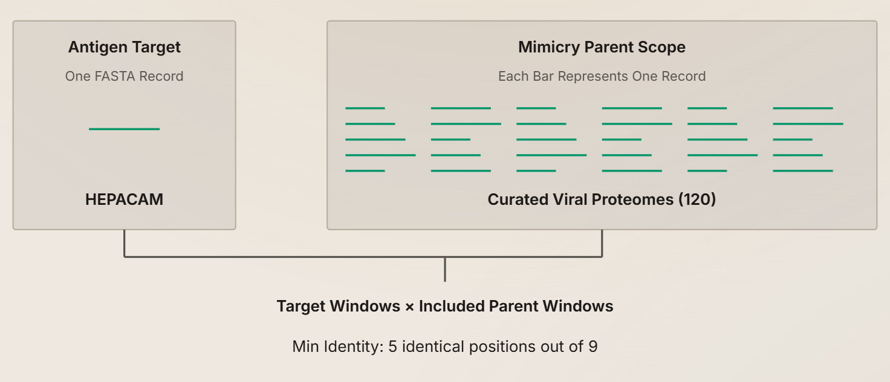
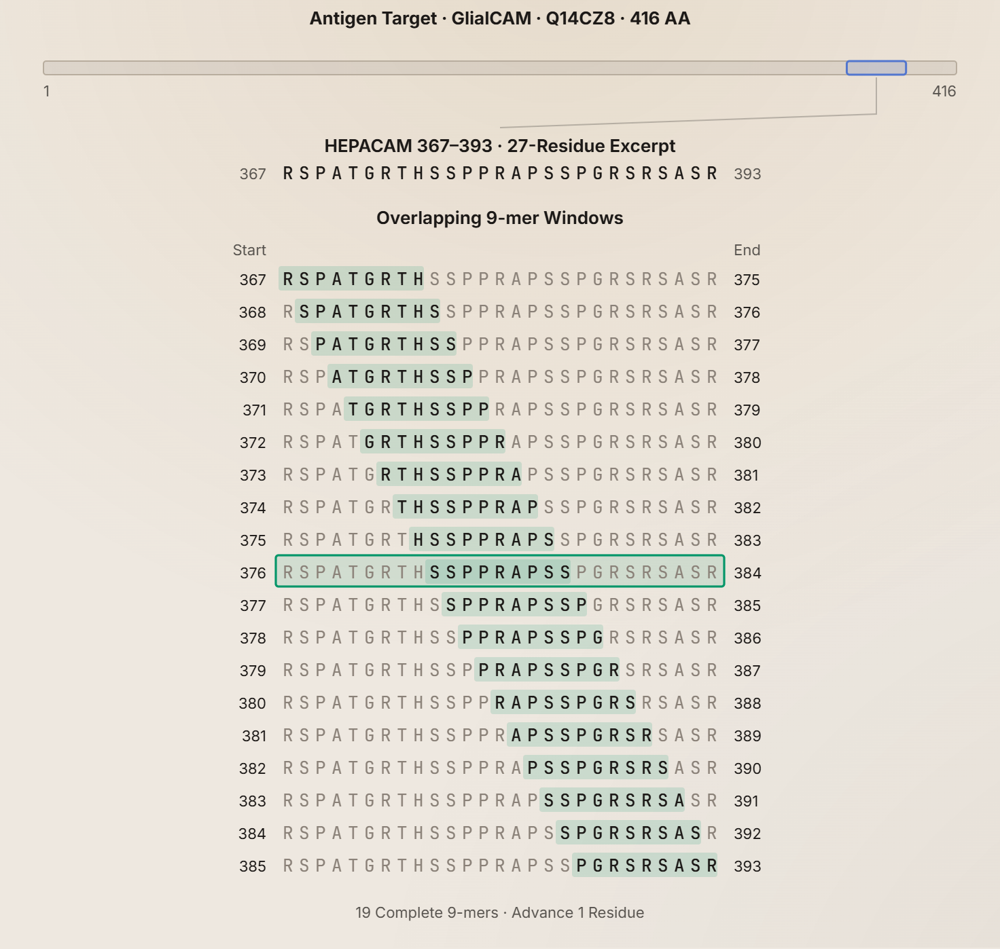
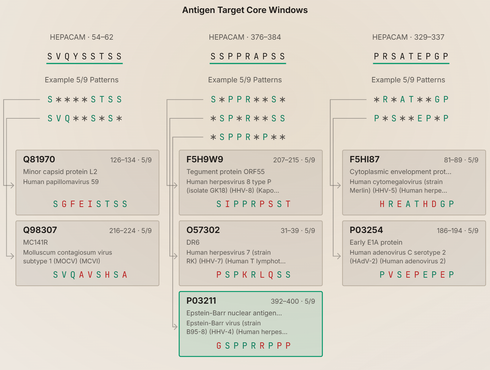
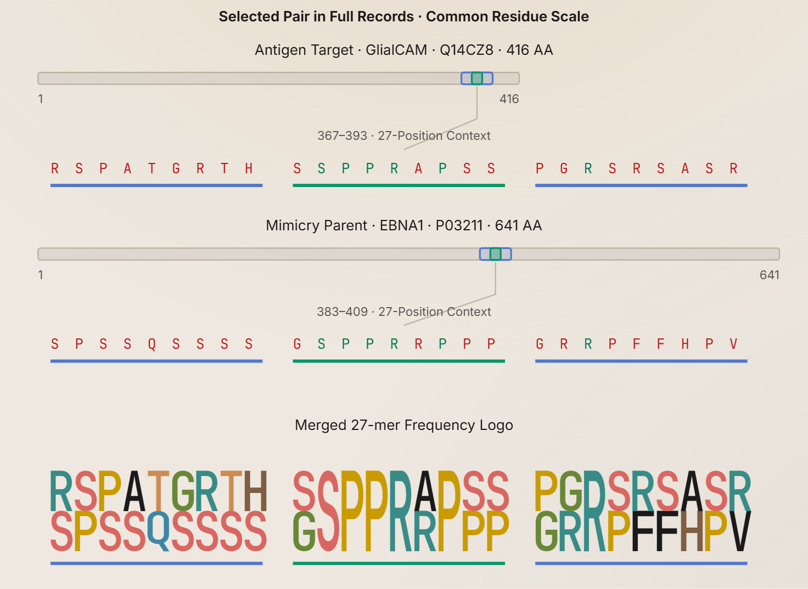
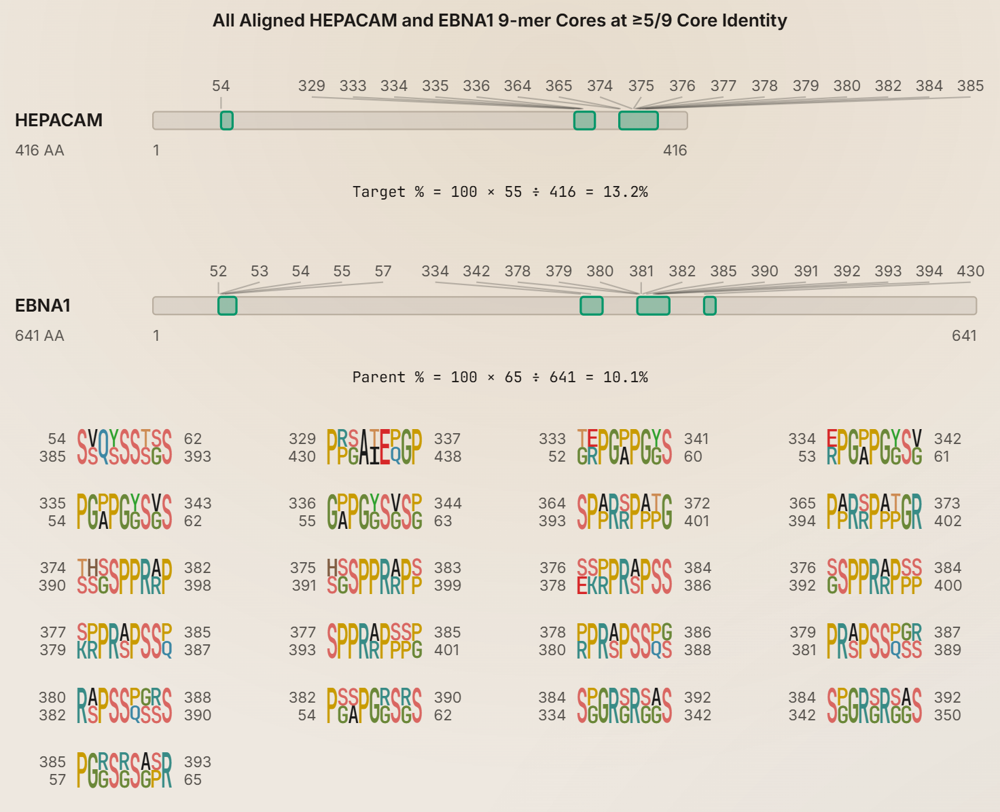

# MimicryMap Pipeline

**Run the supplied FASTAs, or replace them to start a new comparison.** This is the same pipeline package for example inputs and a selected site comparison. Both use the site's comparison worker and CSV calculations.

A download from the player already contains the selected target, complete parent population, and settings; [Current Comparison](docs/COMPARISON.md) describes that selection. The starter download contains an editable example instead; see [Example](docs/EXAMPLE.md).

## Run

Extract the whole ZIP. In the extracted folder:

- **Python:** run `python run.py`, or open run.py in your Python editor and run it.
- **R or RStudio:** set the working directory to the package, then run `source("run.R")`.
- **Terminal:** run `Rscript run.R` or `node run.cjs`.

The Python and R launchers set up Node.js locally if needed. Initial setup requires internet access; subsequent calculations run locally. Input sequences are not uploaded. Windows R requires version 4.2 or later.

## Change the comparison

| File | What to edit |
| --- | --- |
| `inputs/antigen-target.fasta` | One or more target records |
| `inputs/mimicry-parents.fasta` | The parent records to compare against |
| `settings.json` | Identity threshold, optional selected target start, and output folder |

`min_identity` is an integer from 5 to 9. `selected_target_start` is a 1-based start, or `null` to omit the current-window table. Paths are relative to settings.json. Targets run one at a time; unlike the browser, the local pipeline processes every supplied target.

Current Comparison downloads retain the selected record labels, coordinate mappings and available annotations. Keep the supplied input files unchanged to reuse that information. If you change FASTA headers, sequences or record order, or add records, the package reads the new inputs using their FASTA headers. Missing gene, accession and organism information stays blank. See the [Input Guide](inputs/README.md) for supported headers and metadata details.

## Results

Each target has a folder under `outputs/targets/` containing:

- `comparison_summary.csv`, one row with 7/9, 8/9 and 9/9 summary column groups
- `all-matches.csv`
- `overall-mimicry-parents.csv`
- `current-window-slice.csv`, when a target start is selected

`outputs/library_summary.csv` combines the summary rows for all supplied targets.

`run.json` summarizes the settings, counts, coverage, and timings. The inputs and their record metadata are retained once per run. Figures remain available through the site's separate Figure bundle.

Rerunning refreshes the managed output folder after completion. Choose another `output_directory` to keep a separate run. Files you add to an output folder are preserved by requiring a different output folder before replacement; a failed run leaves the previous completed output intact.

[Input Guide](inputs/README.md) · [Table Guide](docs/TABLES.md) · [Glossary](docs/GLOSSARY.md) · [File Guide](docs/FILE-GUIDE.md)

## Site downloads and this package

| Surface | What it provides |
| --- | --- |
| **Summary CSV** in the player | One target at the selected identity threshold and comparison scope, with available target annotations |
| **Current Comparison** | This runnable package with the selected target, complete comparison population, settings, and available identity, mapping and annotation metadata |
| **Plain pipeline ZIP** | The same code and guides with editable example inputs |
| **Mimicry coverage summaries** on Data & Licenses | Reference-population and assay-library comparisons, with Target FASTA and Comparison FASTA beside each CSV |
| **Selected virus / All viruses** on the atlas | Both human-to-virus and virus-to-human directions for the selected reference proteome or the pooled 120-proteome atlas |

To use a download-table row here, save **Target FASTA** as `inputs/antigen-target.fasta` and **Comparison FASTA** as `inputs/mimicry-parents.fasta`. The first population supplies the output rows; each sequence's full length supplies its coverage denominator. Comparison FASTA includes records absent from the summary's parent lists. Replacing the inputs invalidates any previous selection metadata.

The packaged [Summary Download Guide](docs/SUMMARY-DOWNLOADS.md) explains the reference populations, CSV fields, parent-list floor, and conservative uncovered-residue regions. All summary CSVs use two decimal places for coverage percentages. App/local summaries include six additional annotation columns. FASTA inputs alone do not carry the site's mappings, grouping or residue annotations.

## HuProt HEPACAM worked example

[Download the HuProt HEPACAM figures and tables (21.5 MB)](https://github.com/seromics/mimicrymap/raw/refs/heads/main/examples/hepacam-huprot-viral-example.zip). This separate example compares HuProt HEPACAM (JHU19101; Q14CZ8) with 120 whole viral proteomes at 5/9 and 7/9, with an EBV-only 5/9 comparison at HEPACAM 376–384. It contains the saved results and figures; use the runnable package above for a new comparison.

## Sources and licenses

Input records retain their original source attribution and licenses. See the originating data source for its terms of use.

## Reading coverage results

Target coverage is the percentage of target residues covered by qualifying nine-residue windows. Parent coverage uses the parent protein's full length. Overlapping windows cover a residue only once, and every position within a qualifying window contributes to coverage, including mismatches.

The summary includes each parent pair reaching at least 10% coverage on either side. Whole-target coverage and All Matching Parent Count include all qualifying matches. Records shorter than nine residues are marked `Not assessable (<9 AA)`.

Available target annotations accompany Current Comparison downloads and appear in their summary outputs. Replacing the input sequences means the earlier annotations no longer apply.

See the [Table Guide](docs/TABLES.md) for field definitions, coordinates and CSV formatting, and the [Summary Download Guide](docs/SUMMARY-DOWNLOADS.md) for collection-wide summaries.

<!-- calculation-walkthrough:start -->
## How Mimicry Results Are Calculated

MimicryMap compares overlapping nine-residue windows, then maps the qualifying matches back to the full records. The example below follows HEPACAM (GlialCAM) and EBNA1.

The full method is below, walked through for an important example: discovery of the 5/9 molecular mimic core XSPPRXPXX shared between <strong>EBNA1</strong> (from Epstein-Barr virus) and the human neuronal protein <strong>HEPACAM</strong> (also called GlialCAM). Aberrant immunity targeting this site is found in about 1/4 of multiple sclerosis patients and <a href="https://doi.org/10.1038/s41586-022-04432-7">may be a cause of multiple sclerosis</a>. As we will see, 5/9 mimicry events to proteins like HEPACAM are commonly found across human viruses.

### 1. Select Records and Comparison Scope

To start, select a sequence you care about or one recognized by an experimentally identified antibody. This sequence is the <strong>antigen target</strong>. Next, you select a pool of sequences to look for molecular mimicry from; these are its potential <strong>mimicry parents</strong>. A minimum identity threshold setting defines how broad the search is.

In our example, scientists have discovered a monoclonal antibody which bound the human protein HEPACAM (GlialCAM; Q14CZ8). They suspected this antibody might have origins in a natural immune response to a virus with sequence similarity to it. HEPACAM is thus the <strong>antigen target</strong> and 'possible culprit virus proteomes' are the <strong>mimicry parents</strong>. They wish for this search to be very broad and have selected an identity threshold of 5/9.

### 2. Extract Window Pairs

The algorithm begins by deconstructing both the antigen target and mimicry parent sequences into all-possible overlapping 9-mer windows. Each 9-mer must be complete, so the number of total windows per sequence record is its length minus 8 residues. A protein of 9 amino acids thus has one window, a protein of 10 amino acids two, and so on. In our example, HEPACAM is 416 amino acids long and thus has 408 unique 9-mer core windows. Shown is one piece of this process occurring from positions 367 to 393.

Windows per record = max(0, record length − 8)

HEPACAM: 416 − 8 = 408 windows

An identical process is done across the entire mimicry parent library. Across the 120 included viral proteomes, there are 2,222 proteins and 961,063 possible mimicry windows.

Each target window is paired with every parent window, giving the total search space for this experiment:

Possible Window Pairs = 408 × 961,063

= 392,113,704 ≈ 3.92 × 108 possible pairs

### 3. Apply Core Threshold

Within each of the window pairs the target positions are aligned with the parent positions and checked for identical amino acids. At a minimum identity of 5/9, any five or more positions must match and up to four may differ. All-possible 9-mer pairings between the antigen target and mimicry parents are compared; this is often many millions of comparisons.

The illustrated patterns show this process. Five positions require exact matches; each wildcard (*) leaves a position unrestricted. Pairs with motifs like this pass and are called as mimicry events at the 5/9 threshold. At this threshold individual target sites often have multiple matches in the parent library. Non-matching pairs are discarded.

For the selected HEPACAM–EBNA1 pair, XSPPRXPXX shows five identical positions and four differences. This pair qualifies at 5/9 but is just one of many possible ways mimicry may occur at this site.

### 4. Map Context

Each qualifying core pair is located in the original records and extended by up to nine residues on either side. The aligned context contains up to 27 residues and allows for observation and ranking of higher-quality matches; any additional matches here are counted towards the total context identity. The aligned contexts are scored using BLOSUM62, which assigns a similarity score to each aligned amino-acid pair.

Our example of HEPACAM and EBNA1 is not unusual. Matches of this quality occur within most target parent pairings. The extended context adds one additional match for a total context identity of 6/27 and produces a poor BLOSUM62 score of 12 across the aligned 27mers.

### 5. Inspect Results

The full data viewer ranks epitope-level molecular mimics by sortable properties. At a selected site, these are core identity (e.g., 8/9 outranking 5/9), context identity (e.g., 20/27 outranking 6/27), or highest BLOSUM62 score. Parent proteins are additionally given target and parent coverage percentages that allow for easy identification of matches spanning across wider regions. These are computed by the following:

Target Coverage = 100 × covered target residues / target length

Parent Coverage = 100 × covered parent residues / parent length

For the case of HEPACAM and EBNA1, several additional matching sites at 5/9 identity increase the total target and parent coverage to 13.2% and 10.1%, respectively. All matching 9-mers and coverage scores are shown in the accompanying figure. Each is another qualifying molecular mimicry event, alongside XSPPRXPXX.

Across the rest of Epstein-Barr virus, there are numerous other matches to HEPACAM at 5/9 identity. Not only do many proteins mimic HEPACAM more often than EBNA1 at 5/9, at the specific HEPACAM 376–384 9-mer core alone there are 27 pairs of 5/9 identity between it and the EBV proteome. There are even more matches occurring across the full viral proteome search space, including two strong matches at 7/9 identity occurring in non-EBV proteins.
<table><caption>Saved window pairs at HEPACAM 376–384</caption><thead><tr><th scope="col">Parent Scope</th><th scope="col">Min Identity</th><th scope="col">Pairs</th></tr></thead><tbody><tr><th scope="row">Curated EBV B95-8 proteome</th><td>5/9</td><td>27</td></tr><tr><th scope="row">Curated Viral Proteomes (120)</th><td>5/9</td><td>293</td></tr><tr><th scope="row">Curated Viral Proteomes (120)</th><td>7/9</td><td>2</td></tr></tbody></table>
Potential molecular mimicry matches at the level of XSPPRXPXX are widespread. Experimental evidence drove discovery of this event. The goal of this site is to automate the discovery of more.

Sequence resemblance is a descriptive result. It does not by itself establish antibody binding, cross-reactivity or disease causation.

<!-- calculation-walkthrough:end -->
