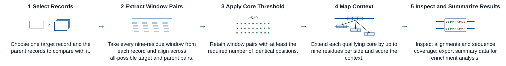

# How MimicryMap Works

Choose target and parent sequence libraries, compare their overlapping nine-residue windows, retain cores meeting the identity threshold, and inspect their original positions and context. Coverage merges qualifying cores independently on each sequence. The same evidence supports readable alignments, coverage and range tables, and sequence-defined sets for Reactivity Enrichment.

## Worked Example

The inputs are HuProt HEPACAM (JHU19101; Q14CZ8; 416 amino acids) and EBNA1 (P03211; 641 amino acids). The selected HEPACAM 376–384 / EBNA1 392–400 site has 5/9 core identity and 6/27 context identity. For HEPACAM versus EBNA1 alone, 21 qualifying window pairs at ≥5/9 merge into 9 + 16 + 30 = 55 covered target residues and 14 + 17 + 25 + 9 = 65 covered parent residues. Target coverage is 100 × 55/416 = 13.2%; parent coverage is 100 × 65/641 = 10.1%. These summarize all observed coordinate matches.

The expanded calculation walkthrough remains in the main README. See [Example](EXAMPLE.md) to run the supplied FASTAs and [Tables](TABLES.md) for output definitions. The worked example illustrates a comparison rule that applies to arbitrary sequence libraries.
