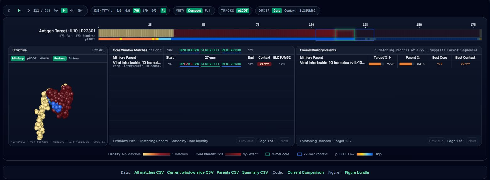

# Viewer Guide

The viewer lets you move along a target sequence, inspect matching cores and
their flanking context, compare coverage in both directions, and export the
result. [Open the hosted viewer](https://seromap.com/mimicrymap/app/index.html),
or run it locally using the instructions below. Both use the same viewer and exporters.



The supplied IL10 example with its optional AlphaFold structure and pLDDT track.
[Example sources and model attribution](../mimicrymap/frontend/embed/examples/PROVENANCE.md).

## Start Locally

With Node.js 24 or later, run this from the repository folder:

```sh
npm run viewer
```

Open the local address printed in the terminal. The command builds the static
viewer and starts a local web server. Keep that terminal running while using it;
press Ctrl+C to stop the server.

1. Click **Compare Sequences** to run the supplied small IL10 example.
2. To use your own sequences, choose **Your FASTAs**, then paste or load target
   and parent FASTAs. Select a target and the minimum identity before comparing.
3. Click along the sequence map or use the playback controls to inspect windows.
   The parent table shows target and parent coverage separately.
4. Use the viewer's export controls for CSVs, a runnable **Current Comparison**,
   or a **Figure Bundle**. **Save Result** retains a viewer JSON that **Open Result**
   can reopen without repeating the scan.

Sequences are compared in your browser. This route needs no database, antibody
study or installed reference pack. A target FASTA can contain multiple records;
the viewer compares the selected target with the supplied parents one target at
a time. Use the [CPU/GPU library builder](BUILD.md) for whole-library computation.

## Add Reference Sequences or Annotations

Start with the small example or your own FASTAs. The optional standard reference
preset is **Human Canonical + 120 Viral Proteomes**: 15.23 MB of input FASTAs,
loaded separately. Loading a library does not automatically run a comparison.
Click **Download FASTAs** to load them from the [published Zenodo dataset](https://doi.org/10.5281/zenodo.24046306), or open local copies with the file selectors.

Choose **Annotations and structure example** in the launcher for the supplied IL10
structure and pLDDT example. Tracks and structures are optional context; they do
not change sequence matching or coverage. The full mapping and structure
collections are separate downloads, not requirements for starting the viewer.

See [Reference Options and Sizes](../mimicrymap/frontend/embed/examples/REFERENCE-LIBRARIES.md)
for the lightweight preset and optional data, and the
[Viewer API](../mimicrymap/frontend/embed/README.md#optional-assets) for supplying
your own tracks and structures.

## Host, Embed or Transfer the Viewer

```sh
npm run viewer:build
```

This creates `dist/viewer`. Serve that folder with a static HTTP server, or
include it in your own website. Open `examples/index.html` for the supplied
launcher. Opening the HTML directly with `file://` is not supported because
workers and JavaScript modules need HTTP.

For an embedded viewer, import `createViewer(element)` from `mimicrymap.mjs`.
No React or other framework is required. The
[Viewer API and Examples](../mimicrymap/frontend/embed/README.md) describe saved
results, instance isolation, optional assets and all supported exports.

`npm run package:viewer` bundles the static viewer and examples into a transferable
ZIP under `dist/`. Extract it and serve the extracted folder over HTTP; it is the
same viewer, without the large reference collections. The hosted site's catalogue
search and saved pan-viral atlas pages additionally need their reference assets
and host services; they are not included in this lightweight viewer package.

[Interface Guide](USAGE.md) · [Detailed CPU Comparison](../README.md#run-a-detailed-comparison-cpu) · [Build Libraries](BUILD.md)
