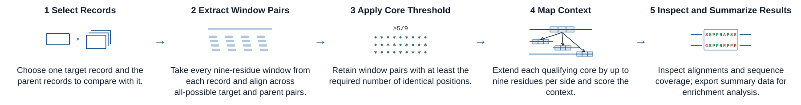
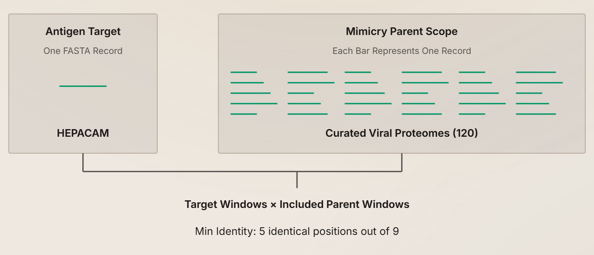
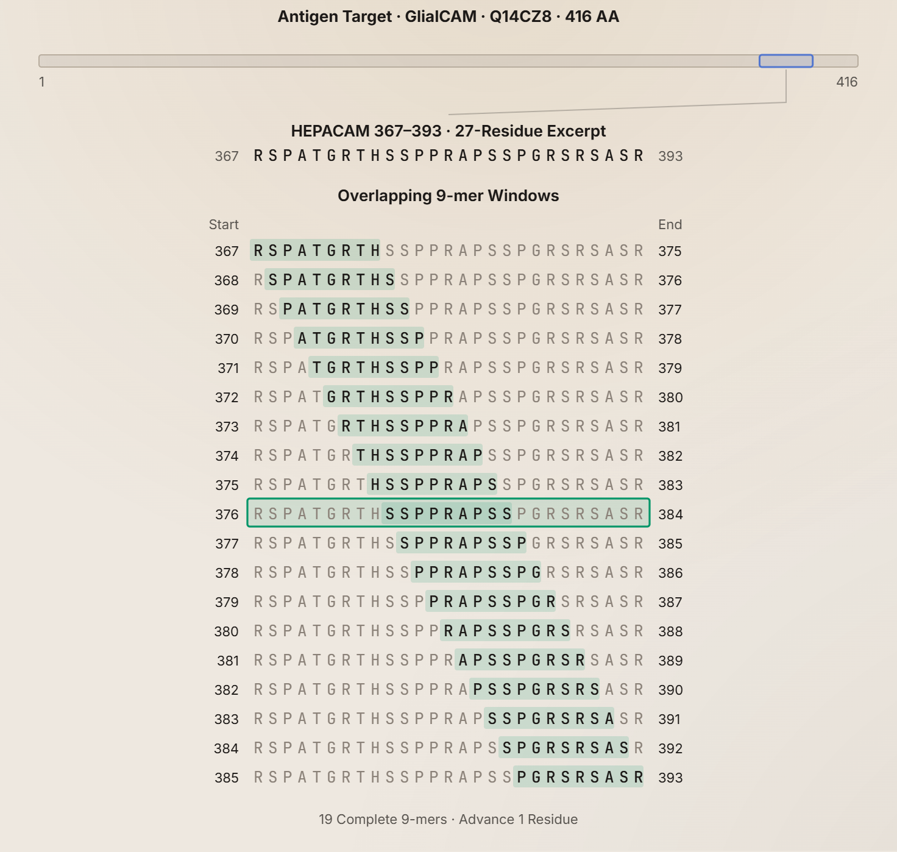
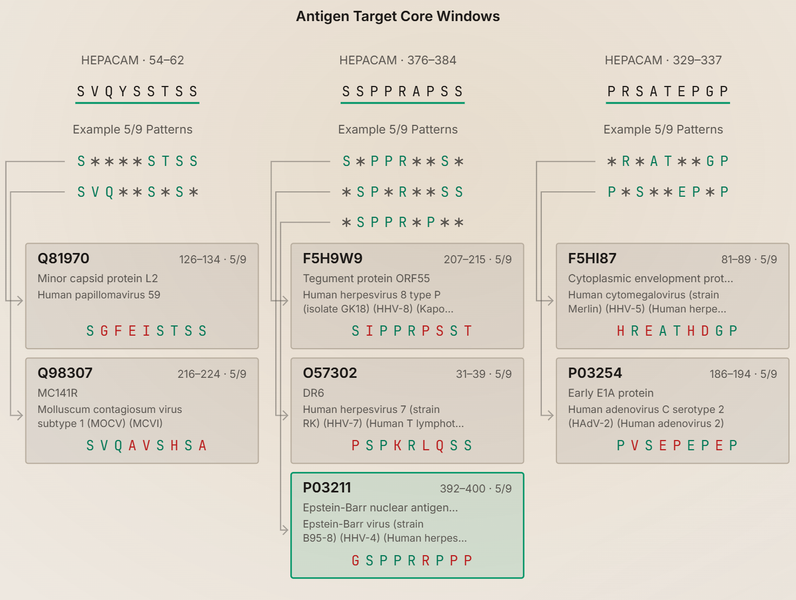
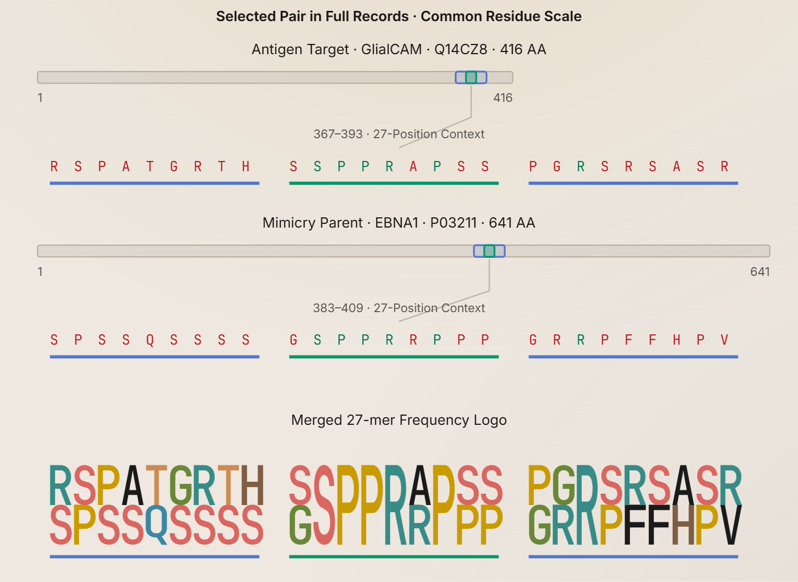
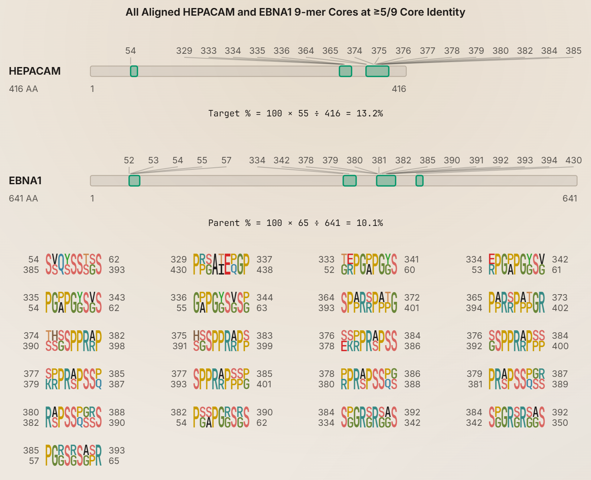
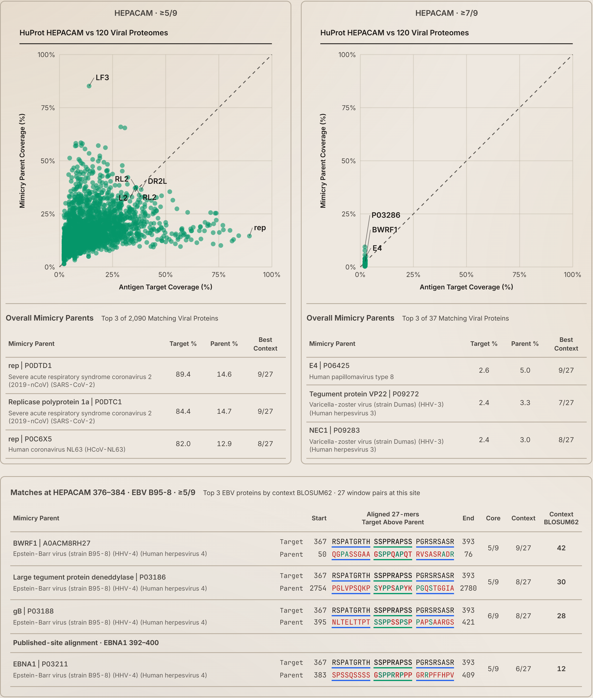
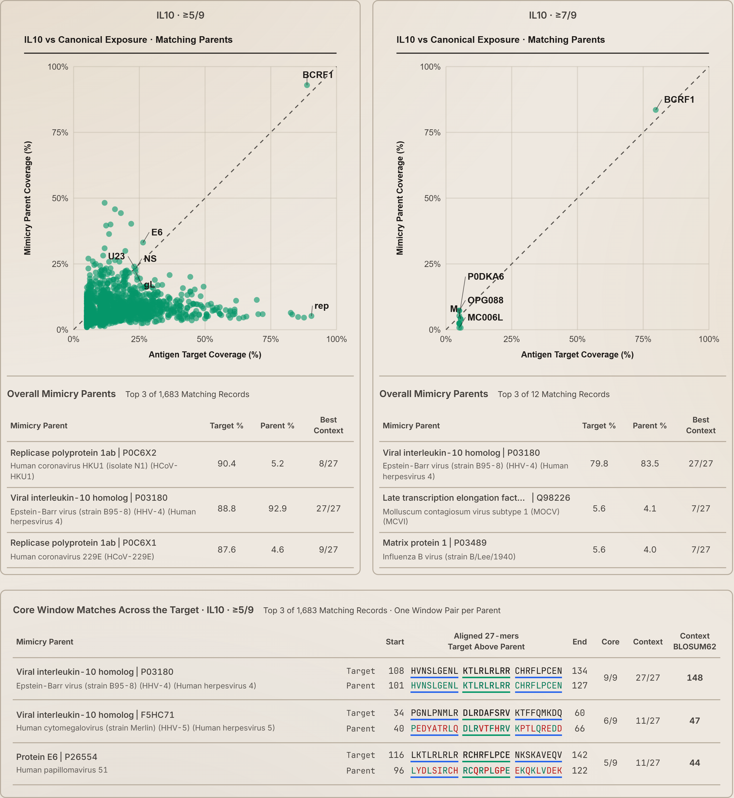
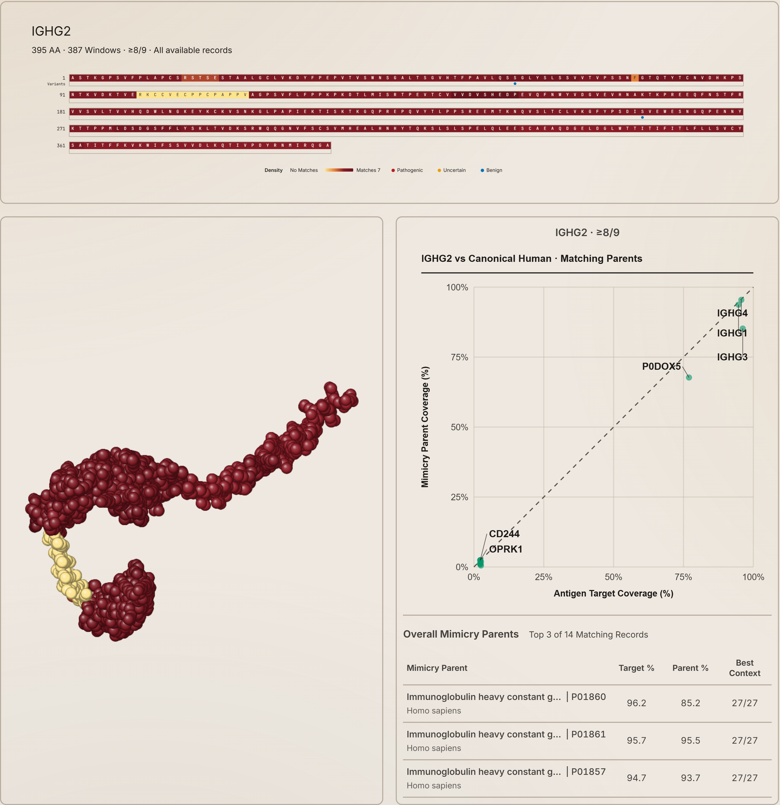

# MimicryMap Pipeline



[Method overview and worked example](docs/HOW-IT-WORKS.md)

**Map antigen-specific sequence resemblance within and across proteomes.**

MimicryMap compares antigen target sequences with a chosen set of parent proteins to find matching amino-acid windows and map where they occur. It reports local sequence similarity and coverage across each protein, helping you explore candidate molecular mimics alongside experimental evidence. This package runs comparisons locally from FASTA files and includes illustrated walkthroughs with downloadable example results. MimicryMap is a linear epitope mimicry tool; its comparisons do not account for 3D structures or post-translational modifications.

**Run the supplied FASTAs, or replace them to start a new comparison.** The package can contain example inputs or a selected site comparison.

The package includes an editable HEPACAM–EBNA1 example. Run it as supplied, or replace the FASTA files and settings with your own comparison; see [Example](docs/EXAMPLE.md).

## Run

Extract the whole ZIP. In the extracted folder:

- **Python:** run `python run.py`, or open run.py in your Python editor and run it.
- **R or RStudio:** set the working directory to the package, then run `source("run.R")`.
- **Terminal:** run `Rscript run.R` or `node run.cjs`.

The Python and R launchers set up Node.js locally if needed. Initial setup requires internet access; subsequent calculations run locally. Windows R requires version 4.2 or later.

## Change the comparison

<table width="100%">
<thead><tr>
<th align="left" width="360">File</th>
<th align="left" width="600">What to edit</th>
</tr></thead>
<tbody>
<tr><td><code>inputs/antigen-target.fasta</code></td><td>One or more target records</td></tr>
<tr><td><code>inputs/mimicry-parents.fasta</code></td><td>The parent records to compare against</td></tr>
<tr><td><code>settings.json</code></td><td>Identity threshold, optional selected target start, and output folder</td></tr>
</tbody>
</table>

`min_identity` is an integer from 5 to 9. `selected_target_start` is a 1-based start, or `null` to omit the current-window table. Paths are relative to settings.json. Targets run one at a time; unlike the browser, the local pipeline processes every supplied target.

Current Comparison downloads retain the selected record labels, coordinate mappings and available annotations. Keep the supplied input files unchanged to reuse that information. If you change FASTA headers, sequences or record order, or add records, the package reads the new inputs using their FASTA headers. Missing gene, accession and organism information stays blank. See the [Input Guide](inputs/README.md) for supported headers and metadata details.

## Results

Each target has a folder under `outputs/targets/` containing:

- `comparison_summary.csv`, one row with 7/9, 8/9 and 9/9 summary column groups
- `all-matches.csv`
- `overall-mimicry-parents.csv`
- `current-window-slice.csv`, when a target start is selected

`outputs/library_summary.csv` combines the summary rows for all supplied targets.

Each run also produces two separate downloads:

- `summaries.zip`: one summary CSV per direction (one for self-comparisons), original FASTAs and a short README.
- `mapping-database.zip`: the SQLite mapping database, original FASTAs for installing its libraries, and installation settings. Extract it and choose its folder in SeroMap with **Import Mapping Database**.

The database stores record identities, aliases, organism metadata, matching pairs, independent ranges and statistical memberships. CSV exports contain the saved pair results. Installation prepares local query indexes without sequence matching. The prepared database also remains available in `indexes/`.

The CSVs are standalone tables. When sharing summary downloads, package one CSV per direction, the original input FASTAs and a short README; keep the SQLite installation package separate. Supported identity thresholds and the 10%-either-side coverage floor are declared in the database's configuration. Full window alignments cannot be reconstructed from independent residue unions.

`run.json` summarizes the settings, counts, coverage, and timings. The inputs and their record metadata are retained once per run. Figures remain available through the site's separate Figure bundle.

Rerunning refreshes the managed output folder after completion. Choose another `output_directory` to keep a separate run. Files you add to an output folder are preserved by requiring a different output folder before replacement; a failed run leaves the previous completed output intact.

[Input Guide](inputs/README.md) · [Table Guide](docs/TABLES.md) · [Glossary](docs/GLOSSARY.md) · [File Guide](docs/FILE-GUIDE.md)

## Site downloads and this package

<table width="100%">
<thead><tr>
<th align="left" width="360">Download</th>
<th align="left" width="600">What it provides</th>
</tr></thead>
<tbody>
<tr><td><strong>Summary CSV</strong> in the player</td><td>One target at the selected identity threshold and comparison scope, with available target annotations</td></tr>
<tr><td><strong>Current Comparison</strong></td><td>This runnable package with the selected target, complete comparison population, settings, and available identity, mapping and annotation metadata</td></tr>
<tr><td><strong>Plain pipeline ZIP</strong></td><td>The same code and guides with editable example inputs</td></tr>
<tr><td><strong>Mimicry coverage summaries</strong> on Data &amp; Licenses</td><td>Paired CSV + FASTA ZIPs and separate SeroMap SQLite ZIPs</td></tr>
<tr><td><strong>Selected virus / All viruses</strong> on the atlas</td><td>Both human-to-virus and virus-to-human directions for the selected reference proteome or the pooled 120-proteome atlas</td></tr>
</tbody>
</table>

To use a download-table row here, save **Target FASTA** as `inputs/antigen-target.fasta` and **Comparison FASTA** as `inputs/mimicry-parents.fasta`. The first population supplies the output rows; each sequence's full length supplies its coverage denominator. Comparison FASTA includes records absent from the summary's parent lists. Replacing the inputs invalidates any previous selection metadata.

The packaged [Summary Download Guide](docs/SUMMARY-DOWNLOADS.md) explains the reference populations, CSV fields, parent-list floor, and per-pair residue ranges. Summary pairs use one decimal place for coverage percentages. App/local summaries include six additional annotation columns. FASTA inputs alone do not carry the site's mappings, grouping or residue annotations.

## HuProt HEPACAM worked example

[Download the HuProt HEPACAM figures and tables (21.5 MB)](https://github.com/seromics/mimicrymap/raw/refs/heads/main/examples/hepacam-huprot-viral-example.zip). This separate example compares HuProt HEPACAM (JHU19101; Q14CZ8) with 120 whole viral proteomes at 5/9 and 7/9, with an EBV-only 5/9 comparison at HEPACAM 376–384. It contains the saved results and figures; use the runnable package above for a new comparison.

## Sources and licenses

Input records retain their original source attribution and licenses. See the originating data source for its terms of use.

## Reading coverage results

Target coverage is the percentage of target residues covered by qualifying nine-residue windows. Parent coverage uses the parent protein's full length. Overlapping windows cover a residue only once, and every position within a qualifying window contributes to coverage, including mismatches.

The summary includes each parent pair reaching at least 10% coverage on either side. Each pair has independently merged target and parent residue ranges. Records shorter than nine residues retain their length and sequence with empty lists.

Available target annotations accompany Current Comparison downloads and appear in their summary outputs. Replacing the input sequences means the earlier annotations no longer apply.

See the [Table Guide](docs/TABLES.md) for field definitions, coordinates and CSV formatting, and the [Summary Download Guide](docs/SUMMARY-DOWNLOADS.md) for collection-wide summaries.

<!-- calculation-walkthrough:start -->
## How Mimicry Results Are Calculated

MimicryMap compares overlapping nine-residue windows, then maps the qualifying matches back to the full records. The example below follows HEPACAM (GlialCAM) and EBNA1.

<p>The full method is below, walked through for an important example: discovery of the 5/9 molecular mimic core XSPPRXPXX shared between <strong>EBNA1</strong> (from Epstein-Barr virus) and the human neuronal protein <strong>HEPACAM</strong> (also called GlialCAM). Aberrant immunity targeting this site is found in about 1/4 of multiple sclerosis patients and <a href="https://doi.org/10.1038/s41586-022-04432-7">may be a cause of multiple sclerosis</a>. As we will see, 5/9 mimicry events to proteins like HEPACAM are commonly found across human viruses.</p>

### 1. Select Records and Comparison Scope



<p>To start, select a sequence you care about or one recognized by an experimentally identified antibody. This sequence is the <strong>antigen target</strong>. Next, you select a pool of sequences to look for molecular mimicry from; these are its potential <strong>mimicry parents</strong>. A minimum identity threshold setting defines how broad the search is.</p>

<p>In our example, scientists have discovered a monoclonal antibody which bound the human protein HEPACAM (GlialCAM; Q14CZ8). They suspected this antibody might have origins in a natural immune response to a virus with sequence similarity to it. HEPACAM is thus the <strong>antigen target</strong> and 'possible culprit virus proteomes' are the <strong>mimicry parents</strong>. They wish for this search to be very broad and have selected an identity threshold of 5/9.</p>

### 2. Extract Window Pairs



<p>The algorithm begins by deconstructing both the antigen target and mimicry parent sequences into all-possible overlapping 9-mer windows. Each 9-mer must be complete, so the number of total windows per sequence record is its length minus 8 residues. A protein of 9 amino acids thus has one window, a protein of 10 amino acids two, and so on. In our example, HEPACAM is 416 amino acids long and thus has 408 unique 9-mer core windows. Shown is one piece of this process occurring from positions 367 to 393.</p>

```math
\begin{aligned}\mathbf{Windows\ per\ record} &= \max(0,\ \text{record length}-8) \\[8pt] \mathbf{HEPACAM:}\quad 416-8 &= 408\ \text{windows}\end{aligned}
```

<p>An identical process is done across the entire mimicry parent library. Across the 120 included viral proteomes, there are 2,222 proteins and polyproteins, with 961,063 possible mimicry windows.</p>

<p>Each target window is paired with every parent window, giving the total search space for this experiment:</p>

```math
\begin{aligned}\mathbf{Possible\ Window\ Pairs} &= 408\times 961{,}063 \\[8pt] &= 392{,}113{,}704\approx 3.92\times 10^8\ \text{possible pairs}\end{aligned}
```


### 3. Apply Core Threshold



<p>Within each of the window pairs the target positions are aligned with the parent positions and checked for identical amino acids. At a minimum identity of 5/9, any five or more positions must match and up to four may differ. All-possible 9-mer pairings between the antigen target and mimicry parents are compared; this is often many millions of comparisons.</p>

<p>The illustrated patterns show this process. Five positions require exact matches; each wildcard (*) leaves a position unrestricted. Pairs with motifs like this pass and are called as mimicry events at the 5/9 threshold. At this threshold individual target sites often have multiple matches in the parent library. Non-matching pairs are discarded.</p>

<p>For the selected HEPACAM–EBNA1 pair, XSPPRXPXX shows five identical positions and four differences. This pair qualifies at 5/9 but is just one of many possible ways mimicry may occur at this site.</p>

### 4. Map Context



<p>Each qualifying core pair is located in the original records and extended by up to nine residues on either side. The aligned context contains up to 27 residues and allows for observation and ranking of higher-quality matches; any additional matches here are counted towards the total context identity. The aligned contexts are scored using BLOSUM62, which assigns a similarity score to each aligned amino-acid pair.</p>

<p>Our example of HEPACAM and EBNA1 is not unusual. Matches of this quality occur within most target parent pairings. The extended context adds one additional match for a total context identity of 6/27 and produces a poor BLOSUM62 score of 12 across the aligned 27mers.</p>

### 5. Inspect Results



<p>The full data viewer ranks epitope-level molecular mimics by sortable properties. At a selected site, these are core identity (e.g., 8/9 outranking 5/9), context identity (e.g., 20/27 outranking 6/27), or highest BLOSUM62 score. Parent proteins are additionally given target and parent coverage percentages that allow for easy identification of matches spanning across wider regions. These are computed by the following:</p>

```math
\begin{aligned}\mathbf{Target\ Coverage} &= 100\times\frac{\text{covered target residues}}{\text{target length}} \\[12pt] \mathbf{Parent\ Coverage} &= 100\times\frac{\text{covered parent residues}}{\text{parent length}}\end{aligned}
```

<p>For the case of HEPACAM and EBNA1, several additional matching sites at 5/9 identity increase the total target and parent coverage to 13.2% and 10.1%, respectively. All matching 9-mers and coverage scores are shown in the accompanying figure. Each is another qualifying molecular mimicry event, alongside XSPPRXPXX.</p>

<p>Across the rest of Epstein-Barr virus, there are numerous other matches to HEPACAM at 5/9 identity. Not only do many proteins mimic HEPACAM more often than EBNA1 at 5/9, at the specific HEPACAM 376–384 9-mer core alone there are 27 pairs of 5/9 identity between it and the EBV proteome. There are even more matches occurring across the full viral proteome search space, including two strong matches at 7/9 identity occurring in non-EBV proteins.</p>

<p><strong>Saved window pairs at HEPACAM 376–384</strong></p>

<table width="100%">
<thead><tr><th scope="col" width="320">Parent Scope</th><th scope="col" width="320">Identity ≥</th><th scope="col" width="320">Pairs</th></tr></thead><tbody><tr><th scope="row">Curated EBV B95-8 proteome</th><td>5/9</td><td>27</td></tr><tr><th scope="row">Curated Viral Proteomes (120)</th><td>5/9</td><td>293</td></tr><tr><th scope="row">Curated Viral Proteomes (120)</th><td>7/9</td><td>2</td></tr></tbody>
</table>

<p>Potential molecular mimicry matches at the level of XSPPRXPXX are widespread. Experimental evidence drove discovery of this event. The goal of MimicryMap is to automate the discovery of more.</p>

Sequence resemblance is a descriptive result. It does not by itself establish antibody binding, cross-reactivity or disease causation.

<!-- calculation-walkthrough:end -->

<!-- interpretation-walkthroughs:start -->
## How to Use Mimicry Results

Combine sequence similarity with experimental evidence, compare coverage, and inspect individual matches with these worked examples.

### 1 · Combine with Experimental Evidence

[Download this example’s saved data and figures](https://github.com/seromics/mimicrymap/raw/refs/heads/main/examples/hepacam-huprot-viral-example.zip)

Single antibodies can cause disease. Using a HuProt protein microarray, [Lanz et al.](https://doi.org/10.1038/s41586-022-04432-7) found that a monoclonal antibody isolated from a multiple sclerosis patient binds the human protein HEPACAM (GlialCAM). Molecular mimicry with Epstein-Barr virus is thought to underlie this cross-reactivity. The [calculation walkthrough](#how-mimicry-results-are-calculated) explains how this match is mapped.

Here, we compare the HEPACAM sequence from a HuProt protein microarray experiment (**JHU19101; Q14CZ8**) with whole viral proteins from **Curated Viral Proteomes (120)**. The known 5/9 match is present but does not stand out by sequence similarity alone. The authors knew to focus on EBV due to [recent work connecting it with MS](https://doi.org/10.1126/science.abj8222), and had separate PhIP-Seq experiments with this same antibody demonstrating binding to proline-rich peptides similar to this match site within HEPACAM. They distinguished this site further by showing phosphorylation of GlialCAM serine 376 (pSer376) increased binding affinity of the tested antibody about 50-fold.



> **Scatter and parent tables:** Each point pairs 416-AA HuProt HEPACAM (JHU19101) with one viral protein or polyprotein. X and Y show covered residues as percentages of the target and parent lengths. Of 2,222 viral proteins and polyproteins across 120 proteomes, 2,090 match at ≥5/9 and 37 at ≥7/9; all matching records are plotted. The parent tables show the top three by target coverage.
>
> **Peptide table:** The EBV-only table holds the target core at HEPACAM 376–384 and shows the three highest-ranked distinct viral proteins by saved context BLOSUM62, followed by the published EBNA1 alignment. Target appears above parent; coordinates refer to the full records. Matches are green, differences red; underlines mark core (green) and flanks (blue). The site-ranking table counts window pairs, with equal BLOSUM62 scores sharing rank.

Download summaries comparing HuProt array features with the 120 reference viral proteomes, in either direction.

[Library-wide summary download guide](docs/SUMMARY-DOWNLOADS.md)


#### Find the published site: HEPACAM 376–384 ↔ EBNA1 392–400

The **EBNA1 P03211** alignment shown below has a 5/9 core and context BLOSUM62 score of 12. It shares rank **15 of 27** window pairs at this HEPACAM site within the EBV B95-8 proteome. The table also places it in the broader 120-proteome comparison.

<table width="100%">
<thead><tr>
<th align="left" width="480">Candidate scope at ≥5/9</th>
<th align="left" width="220">Higher-scoring pairs</th>
<th align="left" width="260">Tied rank / total pairs</th>
</tr></thead>
<tbody>
<tr><td>All HEPACAM positions · 120 viral proteomes</td><td>9,061</td><td>9,062 / 41,011</td></tr>
<tr><td>HEPACAM 376–384 · 120 viral proteomes</td><td>147</td><td>148 / 293</td></tr>
<tr><td>HEPACAM 376–384 · EBV B95-8 only</td><td>14</td><td>15 / 27</td></tr>
</tbody>
</table>

- **Combine measurements** from the same sample or antibody. The figures show sequence matches before filtering by antibody hits.

- **Keep weaker candidates:** a 7/9 cutoff removes this 5/9 match; excluding all Pro/Arg-rich regions would also discard it.

### 2 · Discover Mimicry Across Proteomes

[Download this example’s saved data and figures](https://github.com/seromics/mimicrymap/raw/refs/heads/main/examples/il10-example.zip)

Viruses can evolve molecular mimics of host proteins. Comparing coverage in both directions helps distinguish similarity spanning much of a protein from smaller, localized matches.

Here, the target is human IL10, an immunoregulatory cytokine. Epstein-Barr virus encodes an evolved homolog, BCRF1, that mimics [human IL10 activity](https://doi.org/10.1126/science.2173142). Other viruses, including [human cytomegalovirus](https://doi.org/10.1073/pnas.97.4.1695), also encode functional IL10 mimics. The full extent and mechanisms of viral mimicry remain incompletely understood; these comparisons highlight candidates for investigation, including less extensive similarities whose biological significance is unknown.



> **Scatter and outlier table:** The left panel shows IL10 at ≥5/9 core identity and the right at ≥7/9, using the same curated viral filter. Both comparisons evaluate 2,222 parent records. Each point pairs IL10 with one matching parent record. The axes show covered residues as a percentage of full sequence length: IL10 on the X-axis and its paired parent on the Y-axis. All matching entries are plotted; tables show the top three parent proteins sorted by IL10 coverage. BCRF1 (P03180) is the viral IL10 homolog discussed above.
>
> **Peptide table:** Top three parent proteins ranked by their highest context BLOSUM62 score for IL10 across 120 reference viral proteomes, with one window pair shown per parent. The target appears above the parent; matching residues are green and differences red. Green and blue underlines distinguish core and flanks.

Download human-to-virus results for all 20,431 human UniProtKB/Swiss-Prot records, or use the reverse table to start from a viral protein.

[Library-wide summary download guide](docs/SUMMARY-DOWNLOADS.md)

#### Find these results in the human-to-virus CSV: IL10 (P22301), ≥7/9

<table width="100%">
<thead><tr>
<th align="left" width="480">CSV column</th>
<th align="left" width="220">IL10 value</th>
<th align="left" width="260">Where to look</th>
</tr></thead>
<tbody>
<tr><td>Mimicry Parent at 7/9</td><td>P03180 (BCRF1)</td><td>Viral IL10 homolog in the plot and parent table</td></tr>
<tr><td>Antigen Target Coverage (%) at 7/9</td><td>79.8</td><td>X-axis · Target %</td></tr>
<tr><td>Mimicry Parent Coverage (%) at 7/9</td><td>83.5</td><td>Y-axis · Parent %</td></tr>
</tbody>
</table>

- **Read both coverage values:** a point toward the upper right indicates similarity spanning much of both proteins. High target coverage with low parent coverage means the matches cover much of the target but only a small part of its partner.

- **Look for local matches too:** low overall coverage can conceal a short region of similarity. Use the peptide table to inspect individual matches alongside the whole-protein view.

- **Read the prepared summary:** this CSV contains 7/9, 8/9 and 9/9 results. At 7/9, IL10 has 12 matching parents; only BCRF1 reaches the summary’s 10% coverage floor on either protein.

- **Explore 5/9 for your own target:** preparing and distributing proteome-wide summaries at 5/9 is substantially larger and more computationally demanding, so the prepared downloads start at 7/9. To compute a 5/9 comparison for a target of interest, [download the local pipeline](#run).

### 3 · Find Uniqueness Within Proteomes

[Download this example’s saved data and figures](https://github.com/seromics/mimicrymap/raw/refs/heads/main/examples/ighg2-example.zip)

Avoiding unwanted cross-reactivity is important for drug design and the selection of monoclonal antibody reagents. However, distinctive regions can be difficult to find. The mapping system described here identifies regions unmatched within a chosen comparison population, such as across the entire human proteome.

In this example, IGHG2, the constant region of the IgG2 heavy chain, is compared with the human proteome at ≥8/9 core identity. Only one short stretch is unmatched at this threshold; the remaining regions closely resemble other IgG subclasses such as IgG1, IgG3, and IgG4.



> **Sequence map and structure:** IGHG2 is compared with Canonical Human at ≥8/9 core identity. Tan represents 'no match' at 8/9; the red shaded regions contain matches at ≥8/9 to other closely related human proteins.
>
> **Scatter and outlier table:** Each point pairs IGHG2 with one matching parent record in Canonical Human at ≥8/9 core identity; all 14 matching records are shown. The axes show covered residues as a percentage of full sequence length: IGHG2 on the X-axis and its paired parent on the Y-axis. The table shows the top three parent proteins sorted by IGHG2 coverage and each parent’s maximum context identity.

Download the following CSV for all 20,431 human UniProtKB/Swiss-Prot records prepared this way.

[Library-wide summary download guide](docs/SUMMARY-DOWNLOADS.md)

#### Find these results in the CSV: IGHG2 (P01859), ≥8/9

The paired coverage column gives each listed parent's X- and Y-axis values. Its adjacent region column identifies the covered residues separately on IGHG2 and that parent. The whole-library sequence-map coloring combines evidence from many parents; the CSV preserves their individual footprints.

- **Coverage dots:** IgG1, IgG3 and IgG4 have the greatest coverage overlap with IgG2, highlighting how little of its sequence is distinctive at this threshold. The CSV’s paired target and parent coverage values provide each listed parent’s X- and Y-axis coordinates.

<!-- interpretation-walkthroughs:end -->
